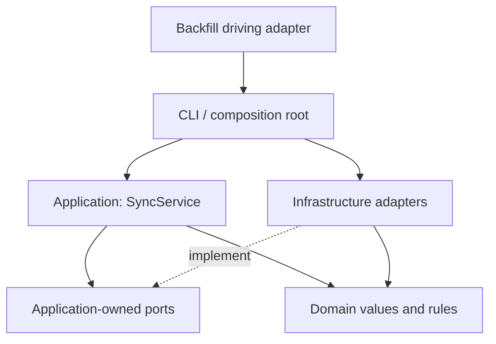

# Architecture

The tool is a lightweight **hexagonal monolith**: one Python distribution, with
inward dependencies and replaceable infrastructure. It is not a collection of
services, a plugin framework, or a dependency-injection container.

## Dependency direction

Arrows describe dependencies, not the direction of downloaded bytes. The
application calls ports; concrete implementations are supplied by the composition
root. Neither the domain nor the application imports adapter implementations.

## Inner layers

`domain/` contains standard-library-only code:

- `models.py`: typed activities, import state, observations, messages, date windows,
  geographic values, normalized health records and sync options. Original payloads
  remain attached so normalization does not discard fields.
- `geography.py`: segment/gap/time rules, repeated-point handling and date-line
  splitting. Results are coordinate values, not OGR objects.
- `health.py`: daily record identity and scalar numeric normalization, including
  requested-day identity for overnight data and multiple same-day weight entries.
- `datasets.py`: dataset semantics, history discovery and request-window policy;
  it contains no service URLs or HTTP parameter mappings.
- `errors.py`: source failure categories and decoding errors, independent of
  HTTP status codes and third-party exception types.

`application/sync.py` supplies the inbound `SyncService.run(SyncOptions)` use case,
plus reusable workflows for indexing, activity imports, workouts and health data.
It owns refresh decisions, resumption, interval coverage, range splitting and
honest failure/completion policy. It does not access SQL connections, local paths,
transport methods, FIT libraries or GDAL objects. Time-sensitive policies accept an
injected date; progress is an injected callable.

## Outbound ports and adapters

Contracts are structural Python `Protocol` interfaces in `application/ports.py`.

| Port | Adapter | Responsibility |
| --- | --- | --- |
| `ActivitySource` | `adapters.garmin.GarminSource` | Typed summaries/details, originals, workouts, health windows and account context |
| `SyncRepository` | `adapters.geopackage.GeoPackageRepository` | Atomic summaries/responses, import checkpoints, query state and reports |
| `ArchiveStore` | `adapters.filesystem.FileArchiveStore` | Private original-archive reads and atomic writes |
| `ActivityDecoder` | `adapters.decoding.OriginalActivityDecoder` | FIT/GPX/TCX decoding into domain samples/messages |
| `Progress` | CLI callback or an in-memory collector | Human-readable progress without coupling workflows to a terminal |

Supporting adapters:

- `http.py` handles credentials, token renewal, HTTPS, throttling and retries.
- `garmin_routes.py` holds vendor paths and parameters. `GarminSource` translates
  transport errors into domain failure categories and maps source summaries.
- `mapping.py` maps vendor summaries and binds typed samples to SQL rows.
  Decoding and geometry operate on domain values, not positional database rows.
- `geometry.py` encodes pure geographic values as OGR geometry. GDAL remains
  responsible for GeoPackage geometry blobs and spatial indexes.
- `validation.py` performs infrastructure-specific SQLite/OGR conformance checks.

The GeoPackage adapter invokes pure normalization/geography rules but owns all SQL,
transactions, schema migration, OGR calls and the interrupted-refresh checkpoint
protocol. It does not expose its SQLite connection through the repository port.

## Driving adapters and composition

`cli.py` validates arguments, acquires the per-database lock, creates adapters,
authenticates, wires `SyncService`, writes the private completion artifact and
presents status/errors. Read-only status and geographic inspection are maintenance
operations implemented by the infrastructure adapters.

`backfill.py` supervises CLI subprocesses using the same installed package, records
its frozen mode/date, retries incomplete work and checks the result. The application
does not know about subprocesses. Resource lifetimes and single-writer locking are
the responsibility of driving adapters; library callers must preserve that contract.

## Entry points and Python imports

The CLI flags and original archive layout are retained. Version **0.5.0** adds
schema **3** for derived 3D tracks; legacy source tables and horizontal features
are preserved. See the [migration and rebuild contract](schema.md#schema-migration-and-offline-rebuilding).
Use the installed CLI for normal operation. Python integrations use the explicit
layers; library callers compose adapters with `SyncService` and preserve locking
and resource lifetimes as described above.

Version **0.3.0** removes the seven root-level import facades introduced during the
initial refactor. This is a breaking change to Python imports, not the CLI or data
format. The package is alpha; these internal module paths are not a stable SDK.

| Removed module | Import from instead |
|---|---|
| `garmin_local_sync.api` | `garmin_local_sync.adapters.http` (`Api`, `ApiError`) |
| `garmin_local_sync.datasets` | `domain.datasets` for policies; `adapters.garmin_routes` for HTTP routes |
| `garmin_local_sync.formats` | `garmin_local_sync.adapters.decoding` |
| `garmin_local_sync.geography` | `garmin_local_sync.adapters.geometry` for OGR; `domain.geography` for pure rules |
| `garmin_local_sync.storage` | `garmin_local_sync.adapters.geopackage` (`GeoPackageRepository`, formerly `Store`); `domain.health` for normalization |
| `garmin_local_sync.sync` | `garmin_local_sync.application.sync`; provide `GarminSource(Api(...))`, not a raw HTTP transport |
| `garmin_local_sync.validation` | `garmin_local_sync.adapters.validation` |

The former `datasets.RANGE_DAYS` convenience map is no longer exported. Read each
policy's `window_days` from `domain.datasets.RANGE_DATASETS` instead.

Version **0.4.0** also removes positional sample/message representations from the
low-level activity pipeline:

- Replace `sample_row(activity_id, index, values, segment)` with
  `adapters.decoding.sample_from_values(index, values, segment)`, returning `Sample`.
- `parse_fit(content, offset=0)` and `parse_xml(content, offset=0)` return typed
  sample/message lists; the redundant activity-ID argument is removed.
- `parse_archive(content)` returns `DecodedActivity`, not a `(rows, messages, format)`
  tuple. Use `.samples`, `.messages` and `.source_format`; samples/messages have
  named fields rather than positional row indexes.
- `GeoPackageRepository.save_activity` accepts typed samples/messages. SQL binding
  and raw JSON encoding occur only inside persistence; do not pre-encode raw fields.

The application port calls `decoder.decode(content, activity_id)` and
`repository.save_import(activity_id, detail, decoded)` remain unchanged. Native
FIT timestamps/bytes in raw payloads are retained until the existing JSON encoder
serializes them for storage; the persisted JSON representation is unchanged.

## Verification

- `tests/test_architecture.py` rejects outward dependencies and verifies core import
  and geographic execution with third-party infrastructure imports blocked.
- `tests/test_application.py` exercises application policy using only in-memory
  ports, including retries, no-data checkpoints, manual activities and idempotence.
- Existing integration tests retain HTTP, CLI, GeoPackage, fault-injection,
  normalization and OGR round-trip coverage.
- Geographic changes require independent GDAL conformance validation; distribution
  changes require an installed-wheel test outside the source checkout.

Keep a running job pinned to its installed distribution. Build/test newer code in a
separate environment; do not replace a backfill's interpreter or package mid-run.
